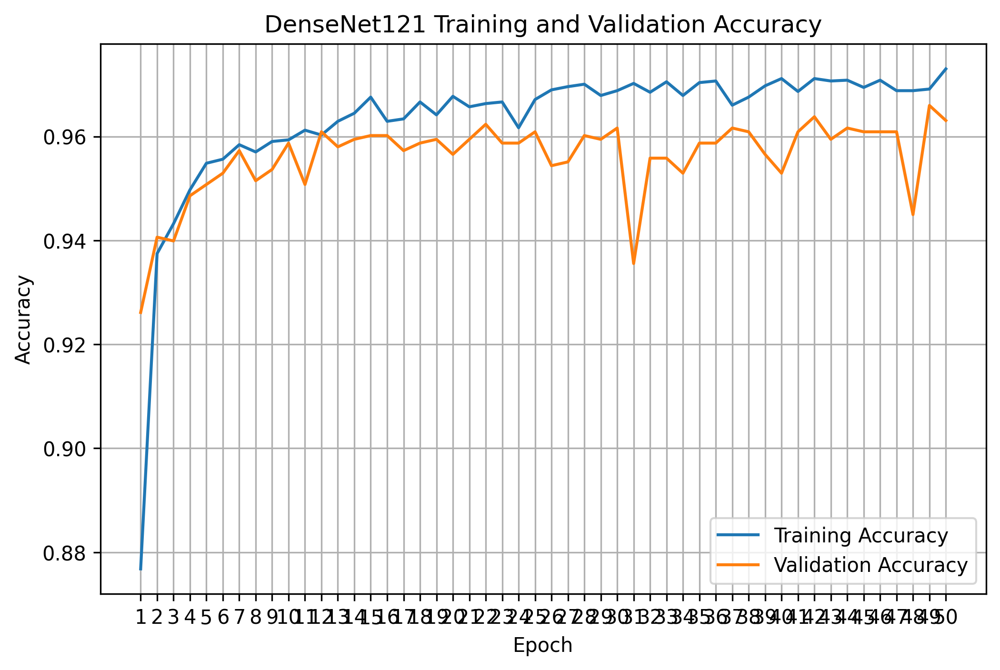
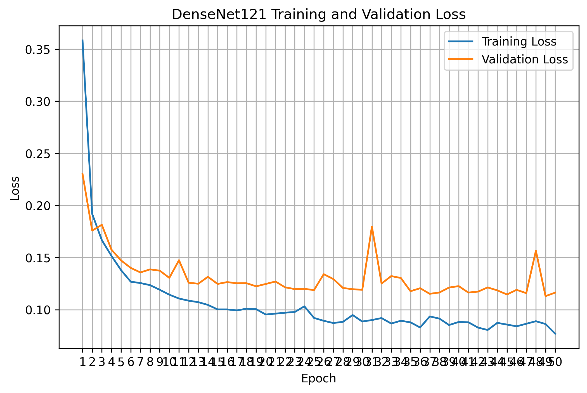
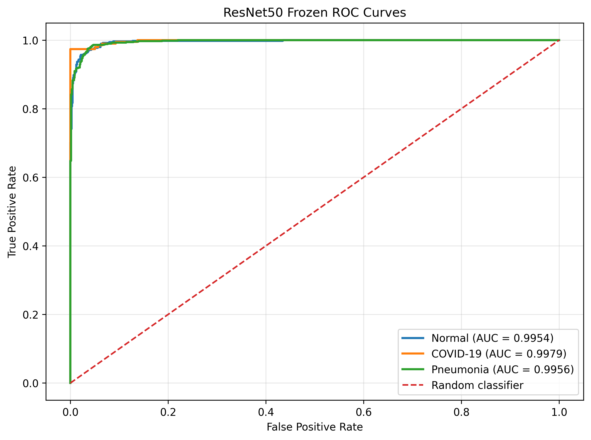

# COVID-19 Chest X-Ray Classification Using Deep Learning

A comparative research project evaluating CNN architectures and transfer learning for classifying chest X-ray images into **Normal, COVID-19, and Pneumonia**.

## Research Objectives

- Establish a baseline using a custom CNN.
- Compare pretrained deep learning architectures.
- Investigate the effect of fine-tuning ResNet50.
- Analyze model performance, generalization, and overfitting.

## Models

| Model | Approach |
|---|---|
| Custom CNN | Training from scratch |
| ResNet50 | Frozen transfer learning |
| DenseNet121 | Frozen transfer learning |
| EfficientNet-B0 | Frozen transfer learning |
| ResNet50 | Fine-tuning from the frozen checkpoint |

## Dataset

The project uses the Curated COVID-19 Chest X-Ray Dataset.

| Split | Images |
|---|---:|
| Training | 6,445 |
| Validation | 1,381 |
| Test | 1,382 |
| **Total** | **9,208** |

**Classes:** Normal, COVID-19, Pneumonia.

Preprocessing includes resizing images to 224 × 224, ImageNet normalization, and training-time augmentation.

Kaggle Dataset: https://www.kaggle.com/datasets/francismon/curated-covid19-chest-xray-dataset

## Fine-Tuned ResNet50 Results

| Metric | Result |
|---|---:|
| Best validation loss | 0.0615 |
| Validation accuracy at epoch 23 | 98.19% |
| Highest validation accuracy | 98.26% |
| Final training accuracy | 99.46% |

These are validation results, not test-set results. The training curves suggest possible overfitting during later epochs.

## Visual Results

### Training and Validation Curves




### ROC Curve



## Technologies

Python · PyTorch · Torchvision · NumPy · Pandas · Matplotlib · Scikit-learn · Kaggle Notebooks

## Repository Structure

```text
├── notebooks/
├── src/
├── configs/
├── experiments/
├── reports/
└── README.md
```

## Future Work

- Complete test-set evaluation and model comparison.
- Analyze class-wise precision, recall, F1-score, and confusion matrices.
- Investigate Grad-CAM explainability.
- Evaluate robustness and external generalization.

## Disclaimer

This project is for research and educational purposes only. It is not intended for clinical diagnosis.
